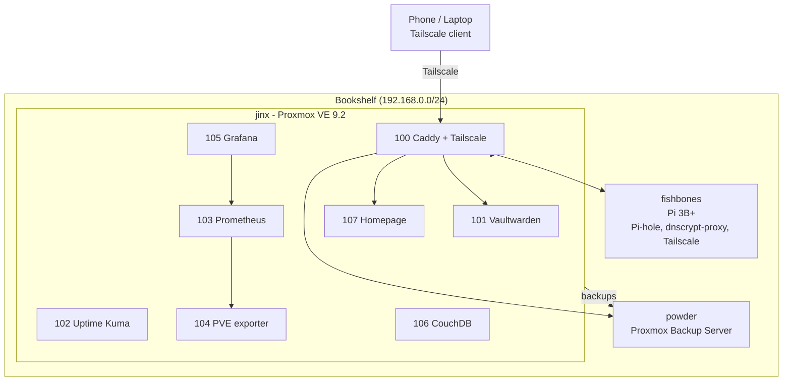

# Bookshelf Homelab

> [!WARNING]
> **OFFLINE while I relocate.** The whole lab is powered down and being moved, so nothing here is reachable right now. This README describes the lab as it was last running. The bring-up steps are at the bottom.

A small, quiet homelab on a 3-tier bookshelf: a Proxmox host, a Proxmox Backup Server, and a Raspberry Pi doing DNS. Everything is reachable remotely over Tailscale with real HTTPS and no port forwarding. Hosts are named with an Arcane theme (jinx, powder, fishbones).

It is both a learning environment and a portfolio piece. This repo is the documentation. Secrets, keys and tokens are never committed, and placeholders like `<tailnet>` stand in for real names.

## Architecture

## Hardware

| Name | Hardware | CPU / RAM | Storage | Role | IP |
|---|---|---|---|---|---|
| **jinx** | Dell OptiPlex 7060 Micro | i5-8500T, 16 GB | 512 GB Samsung 870 EVO | Proxmox VE 9.2 | 192.168.0.11 |
| **powder** | HP ProDesk 400 G4 DM | i5-8500T, 16 GB | 512 GB Patriot 210 | Proxmox Backup Server 4.x | 192.168.0.12 |
| **fishbones** | Raspberry Pi 3B+ | 1 GB | 32 GB SanDisk Max Endurance | Pi-hole v6, dnscrypt-proxy, Tailscale | 192.168.0.10 |

Also on the shelf: a custom 3D-printed 10-inch patch panel bracket, designed in Onshape. jinx and powder run Avahi, so they answer to `.local` names.

## Services

| LXC | Service | Address | Reached via |
|---|---|---|---|
| 100 | Caddy + Tailscale | 192.168.0.189 | `caddy.<tailnet>.ts.net` |
| 101 | Vaultwarden | 192.168.0.203:8000 (HTTPS) | Caddy `:8000` |
| 102 | Uptime Kuma | 192.168.0.30:3001 | LAN |
| 103 | Prometheus | 192.168.0.166:9090 | LAN |
| 104 | PVE exporter | 192.168.0.137:9221 | scraped by Prometheus |
| 105 | Grafana | 192.168.0.175:3000 | LAN |
| 106 | CouchDB (Obsidian LiveSync) | 192.168.0.98:5984 | LiveSync clients |
| 107 | Homepage | 192.168.0.157:3000 | Caddy `:8888` |

Caddy also proxies Pi-hole on `:8080`, the Proxmox UI on `:8006` and the PBS UI on `:8007`. Backups go to the `jinx-backup` datastore on powder (about 452 GB), added to Proxmox as storage `powder`. node_exporter v1.11.1 runs on all three hosts.

> [!NOTE]
> **Vaultwarden is running but not really in use**, and may never be. It stays up so the option exists. It still needs hardening before any real passwords go in (see the roadmap).

## How it fits together

- **DNS:** Pi-hole v6 on fishbones filters the network and is the tailnet nameserver. Upstream queries go through dnscrypt-proxy on `127.0.0.1#5053`.
- **Remote access:** Tailscale with MagicDNS and per-node HTTPS certs. Servers run `--accept-dns=false`. No router ports are forwarded.
- **Reverse proxy:** Caddy runs in an LXC with Tailscale inside it (TUN device lines in the container config, and `tailscale set --operator=caddy` so Caddy can fetch certs). Services are port-based URLs under one hostname.
- **Backups:** Proxmox adds PBS as storage using an API token, a datastore ACL and the PBS certificate fingerprint.
- **Monitoring:** node_exporter on every host and prometheus-pve-exporter (read-only credentials, scraped at `/pve`) feed Prometheus. Grafana runs dashboards 1860 and 10347. Uptime Kuma watches services by raw IP and publishes a status page that Homepage reads.
- **Notes sync:** Obsidian Self-hosted LiveSync on CouchDB 3.5, with CORS enabled and end-to-end encryption.
- **Dashboard:** Homepage, with API-token widgets and `HOMEPAGE_ALLOWED_HOSTS` set.

## Decisions

| Decision | Why |
|---|---|
| Tailscale instead of port forwarding | No inbound exposure, easy remote access |
| Caddy instead of Nginx Proxy Manager | Tailscale issues per-node certs but no wildcards, so NPM subdomains gave cert mismatches. Caddy with port-based URLs works cleanly |
| dnscrypt-proxy instead of Unbound | TCP/53 is blocked on my network, which Unbound's recursion needs |
| Not cloudflared | Deprecated |
| Backups on separate hardware | powder holds the backups, not the machine being backed up |

## Troubleshooting

| Problem | Cause | Fix |
|---|---|---|
| Pi static IP via dhcpcd did nothing | Pi uses NetworkManager | Set it with `nmcli` |
| Proxmox lost DNS after installing Tailscale | Tailscale rewrote `resolv.conf` | `tailscale set --accept-dns=false` |
| Pi-hole exporter returned nothing | It targeted the v5 API | Removed it |
| PVE exporter showed no data | Placeholder creds, wrong metrics path | Real read-only creds, `metrics_path: /pve` with `params` |
| PBS storage add failed (401, fingerprint) | No token ACL, fingerprint missing | API token, datastore ACL, fingerprint in the dialog |
| PBS login broke after a `user.cfg` edit | Spaces instead of tabs | Rewrote the file with tabs |
| node_exporter would not start | Orphaned process held port 9100 | Found it with `ss -tlnp`, killed it, restarted the service |
| LiveSync errors (CORS, uploads, HKDF, broken files, lockout) | CORS off, out-of-sync data | Enabled CORS, "Scan storage and database again", "Overwrite Server Data with This Device's Files", waited out the CouchDB lockout |
| DNS conflict between Mullvad and Tailscale | Both managing DNS | Cleared by rebooting |
| Whole lab offline for about a month | Switch uplink cable unplugged at the router | Plugged it back in |

## Roadmap

**Priority**
- [ ] DHCP reservations for the LXCs (addresses are hard-coded in configs)
- [ ] SSH key auth, then disable password login
- [ ] Review firewall rules (they predate Caddy)
- [ ] Alerting from Uptime Kuma and Grafana
- [ ] Vaultwarden hardening: admin token, close sign-ups
- [ ] Tailscale widget for Homepage

**Backups**
- [ ] Back up the host configs (only guests go to PBS today)
- [ ] Offsite copy of the PBS datastore
- [ ] Restic for archive data
- [ ] Test a restore

**Hardware**
- [ ] Move jinx to NVMe: back up to PBS, reinstall on NVMe, restore
- [ ] UPS
- [ ] Label cables and ports

## After

1. Shut down cleanly: guests, then jinx, powder, fishbones.
2. Power on in order: router and switch, fishbones, powder, jinx, then the LXCs.
3. Check the LAN subnet still matches the addresses above. If not, the hard-coded LXC addresses need updating.
4. Confirm Tailscale is connected and Pi-hole is still the tailnet nameserver.
5. Check Caddy, Homepage, Prometheus targets and Grafana, then run a PBS backup.
6. Remove the offline banner at the top.
